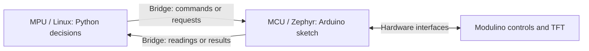

# Arcade pre-work and references

[Arcade guide](README.md) · [Arduino references](#arduino-references)

Allow about **30 minutes**, plus download time. This estimate includes the MPU/MCU introduction, computer preparation, and a starter walkthrough. No board is needed for the reading and code walkthrough.

By the end, you should be able to explain what runs on each UNO Q processor, why that split helps your project, and what information crosses between them. Familiarity with variables, functions, loops, and conditionals is useful; you will develop the hardware-specific parts during the session.

## 1. Understand MPU and MCU roles — about 10 minutes

An **MPU (microprocessor unit)** is suited to general-purpose computing, typically using external RAM and storage to run an operating system and applications. An **MCU (microcontroller unit)** combines a processor, memory, and hardware peripherals on one chip for embedded control.

The UNO Q has both. Its Qualcomm Dragonwing **QRB2210 MPU runs Debian Linux**, while its **STM32U585 MCU runs Arduino sketches on Zephyr**, a real-time operating system. See Arduino's [UNO Q overview](https://docs.arduino.cc/hardware/uno-q/) and the architecture section of the [UNO Q user manual](https://docs.arduino.cc/tutorials/uno-q/user-manual/).

| Aspect | MPU: computing and application logic | MCU: hardware interaction and timing |
| --- | --- | --- |
| Strengths | More compute and memory for images, Python libraries, networking, files, and Linux applications | Direct hardware interfaces, timers, and predictable control with a smaller memory and power budget |
| Programming in this starter | Python in `python/`; Linux also runs the optional RetroArch workflow | Arduino C++ in `sketch/sketch.ino`, with `setup()` for initialization and `loop()` for repeated work |
| Tradeoffs | Linux schedules multiple tasks; a Python loop is not a guarantee of precise hardware timing | Less memory and compute; long or blocking sketch work can still delay input handling and timer checks |
| Arcade responsibility | Apply control calibration and game rules; run a Linux game in the RetroArch option | Read physical controls and drive the console's TFT |

**Real-time** means responding within a required time bound, not simply running calculations faster. The MCU is a good home for timing-sensitive work, but the sketch still has to be written to service it promptly. An MCU can run an OS, as this one does; the distinction is about resources and responsibilities, not just whether an OS is present.

## 2. Follow how they work together — about 5 minutes

Arduino App Lab manages the Python program and Arduino sketch as one app. Both programs run on the UNO Q; your connected computer provides the editor. **Bridge** connects the two programs using remote procedure calls (RPC): one side asks the other to run a named function and exchange values. Read the C++ and Python sections of the [Bridge API reference](https://docs.arduino.cc/software/app-lab/bridge/bridge-api).

In this starter, the sketch exposes named functions with `Bridge.provide_safe(...)`. Python calls them with `Bridge.call(...)`, which waits for a response. Method names, argument order, and return values must agree on both sides. They are separate programs exchanging messages, so calls take time and can fail.

Python requests input values, updates game state, then sends compact drawing values to the MCU. This uses Linux's software ecosystem alongside dedicated hardware control. Keep messages small and retain the starters' stop, timeout, and error handling.

## 3. Prepare your computer — about 5 minutes, plus download time

1. Install and open Arduino App Lab using its [setup guide](https://docs.arduino.cc/software/app-lab/setup/overview/). Read the [board connection guide](https://docs.arduino.cc/software/app-lab/configure/config/); complete board connection when you receive your kit.
2. Download this repository and locate your track's `app.yaml`, `python/`, and `sketch/`. The [Arcade guide](README.md) explains packaging and importing them together.
3. Bring a data-capable USB-C cable. The kits are preassembled; keep their prepared wiring and board software in place. If installation is blocked, record the error for setup help and continue the reading and code walkthrough.

**Check your understanding:** choose one task for the MPU and one for the MCU in your track. Explain why each belongs there, and name one command and one result that must cross Bridge. Then continue with the starter walkthrough below.

## 4. Walk through the starter — about 10 minutes

1. **Trace one input-to-display cycle.** Open [`python/main.py`](python/main.py). Follow `Bridge.call("arcade_read_inputs")` to `readInputs()` in [`sketch/sketch.ino`](sketch/sketch.ino), then follow `Bridge.call("arcade_draw_frame", ...)` to `drawFrame()`. The MCU reads the controls and drives this kit's TFT; Python on the MPU applies calibration and is where you will add game rules.
2. **Meet the controls.** Skim the official [Joystick](https://docs.arduino.cc/hardware/modulino-joystick/), [Buttons](https://docs.arduino.cc/hardware/modulino-buttons/), and [Movement](https://docs.arduino.cc/hardware/modulino-movement/) pages. Match each to the [starter's input fields](README.md#app-lab-draw-directly-on-the-tft). Read the defaults in [`python/preview.py`](python/preview.py): a dead zone ignores small changes around neutral, and the Movement baseline centers acceleration readings for the playing position. These readings are not tilt angles.
3. **Plan a small game.** Write one sentence each for the objective, control mapping, win/lose condition, and restart action. Choose what Python must send to the sketch to draw it, such as a position and score. Use a new button press for one-shot actions so holding a button does not repeatedly score or restart.

**Ready for the session:** you can trace “control → MCU input snapshot → Bridge → Python game state → Bridge → MCU drawing,” and explain why sending a few values can be cheaper than sending every pixel. When you receive the console, the [live preview](README.md#2-run-the-app-lab-starter) is your first hardware checkpoint. Start there even if you later choose RetroArch; it also runs on the MPU and uses the MCU for controls and the TFT.

## Arduino references

Use these as lookups during this track; you do not need to read every page end to end.

| Official documentation | What to focus on |
| --- | --- |
| [UNO Q user manual](https://docs.arduino.cc/tutorials/uno-q/user-manual/) | Board architecture, processor roles, connectors, and operating limits |
| [App Lab setup](https://docs.arduino.cc/software/app-lab/setup/overview/) and [board connection](https://docs.arduino.cc/software/app-lab/configure/config/) | Installing the development environment and connecting to the board |
| [Bridge API reference](https://docs.arduino.cc/software/app-lab/bridge/bridge-api) | Registering functions, calling them from Python, and matching data types |
| [Debian Linux basics for UNO Q](https://docs.arduino.cc/tutorials/uno-q/debian-guide/) | Working with files, packages, networking, and processes on the MPU |
| [Modulino Joystick](https://docs.arduino.cc/hardware/modulino-joystick/) | Two directional axes, the stick's pushbutton, and Qwiic connectivity |
| [Modulino Buttons](https://docs.arduino.cc/hardware/modulino-buttons/) | The three buttons and their indicator LEDs |
| [Modulino Movement](https://docs.arduino.cc/hardware/modulino-movement/) | Acceleration and rotation sensing; this starter exposes acceleration |
| [Arduino_Modulino library](https://docs.arduino.cc/libraries/arduino_modulino/) | Module initialization and APIs when extending the sketch |

Some Arduino examples target other boards or newer library versions. Keep this starter's pinned dependencies and its UNO Q `Wire1` setup; its joystick and button snapshots use explicit I2C reads. The supplied TFT uses the separate driver documented in the [hardware reference](README.md#hardware-reference).
