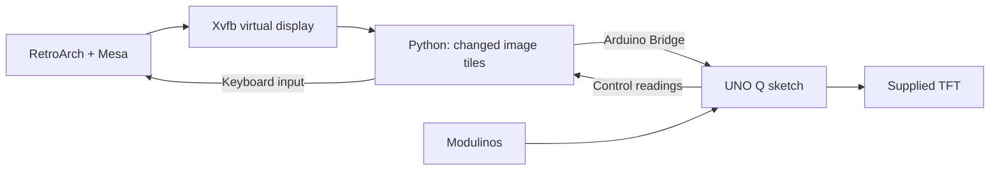

# Run RetroArch on the console TFT

[Arcade guide](../README.md) · [Display reference](../README.md#hardware-reference) · [Calibration](../README.md#3-adjust-the-controls)

Run a software-rendered libretro game on UNO Q Linux and play it with the console's joystick and buttons. The launcher sends the picture to the supplied DIYables TFT; no separate screen is needed.

This route suits **slow or mostly static games**. The picture is 160×120, enlarged into a centered 320×240 area of the TFT, and full-screen changes take seconds. Use the App Lab drawing routines for fast-response games. You supply the core, content, and appropriately licensed assets.

## 1. Start the Arcade app

Import and run the [Arcade starter](../README.md#2-run-the-app-lab-starter). Leave it running while using RetroArch. Its sketch handles the display and Modulinos, and its Python preview yields while the launcher owns the screen.

Use this repository's starter for both workflows. The reference Arcade Bundle's HID app uses different firmware.

## 2. Open a terminal on UNO Q

The launcher runs **on UNO Q Linux**, outside the App Lab Python container.

If you have a prepared console, use the supplied terminal connection and folder location. For USB access, install [Android SDK Platform-Tools](https://developer.android.com/tools/releases/platform-tools) on your computer and add its folder to your command path. Connect the UNO Q, then run in your computer's terminal:

```sh
adb devices
adb shell
```

The prompt is now on the board. If several devices are listed, use `adb -s SERIAL shell` with the UNO Q's serial. Keep the terminal open while playing.

Change to the supplied folder containing `arcade/`. If the launcher has not been installed yet, complete [first-time setup](#first-time-setup) below.

## 3. Open the menu

From the folder containing `arcade/`, run:

```sh
sh arcade/retroarch/run.sh
```

RetroArch's MaterialUI menu appears on the TFT with enlarged text. Use the joystick to move, **B to confirm**, and **A to go back**.

| Physical input | Game input |
| --- | --- |
| Joystick directions | D-pad |
| Button A | RetroPad B |
| Button B | RetroPad A |
| Button C | Start |
| Joystick press | Select |
| C + joystick press together | Open or close the RetroArch menu |

To quit, choose **Quit RetroArch** or press **Ctrl+C** in the launch terminal. To return to the App Lab preview, stop and run the starter again in App Lab. Run the launcher command again whenever you want to return to RetroArch.

## 4. Launch your game

Quit the menu, then launch the installed core and content directly:

```sh
sh arcade/retroarch/run.sh --core /path/to/core_libretro.so --content /path/to/your-game
```

Replace both paths with your files. Omit `--content` for a core that runs without content. Keep this command with your project so another person can start it without navigating the menu.

The launcher supports software-rendered cores and joystick/button input. GPU-rendered cores, shaders, audio, touch, and Movement control are not included. The joystick uses `DEAD_ZONE`, `INVERT_X`, and `INVERT_Y` from [`python/preview.py`](../python/preview.py); update both the checkout and imported App Lab copy when changing them.

Play a full round and restart using the console controls. Choose a game whose timing works with the display's progressive updates, then continue with the [game design guide](../README.md#5-build-one-complete-round).

## First-time setup

Prepare this once per console, with Internet access. The App Lab import ZIP does not install the Linux launcher.

From the repository root on your **computer**, copy the complete Arcade folder to the board:

```sh
adb shell mkdir -p /home/arduino/uno-q-guides
adb push arcade /home/arduino/uno-q-guides/
adb shell
```

Then, in the **UNO Q terminal**:

```sh
cd ~/uno-q-guides
sudo apt update
sudo apt install retroarch retroarch-assets xvfb xauth python3-venv libgl1-mesa-dri libegl1
python3 -m venv arcade/retroarch/.venv
arcade/retroarch/.venv/bin/python -m pip install -r arcade/retroarch/requirements.txt
```

Enter the board user's password when `sudo` asks. Run the launcher as that normal user, with access to `/var/run/arduino-router.sock`.

The configuration uses RetroArch's OpenGL/EGL renderer, X11 input, MaterialUI assets, and Mesa's `llvmpipe` CPU renderer. Keep [`retroarch.cfg`](retroarch.cfg) and [`run.sh`](run.sh) together with the launcher. Install your software-rendered libretro core and any required content or BIOS using the [Libretro Linux guide](https://docs.libretro.com/guides/install-gnu/).

## How the display bridge works



The launcher captures a private 160×120 display, converts it to RGB332 color, and sends changed 16×8 tiles. Each payload is at most 129 bytes, keeping complete requests inside the 256-byte RPC limit. A tile is cached only after the sketch acknowledges it.

The sketch enlarges each tile 2×. At the pinned 115200-baud Bridge speed, large redraws are slow; sparse changes transfer more quickly. The terminal reports tile throughput and RPC time while the game runs. Capture frequency is not the TFT frame rate.

Keyboard input is confined to the private Xvfb session. The launcher releases held keys and its display session on exit; the sketch also expires an inactive session after 1.5 seconds. The configuration leaves RetroArch's default settings file unchanged.
